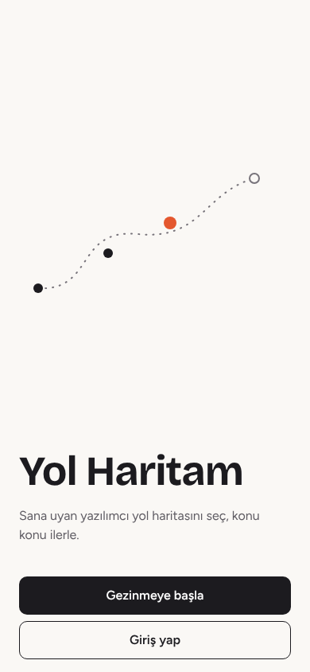
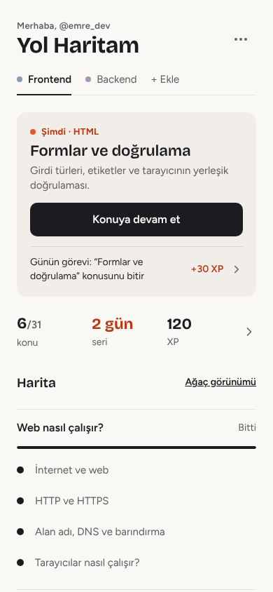
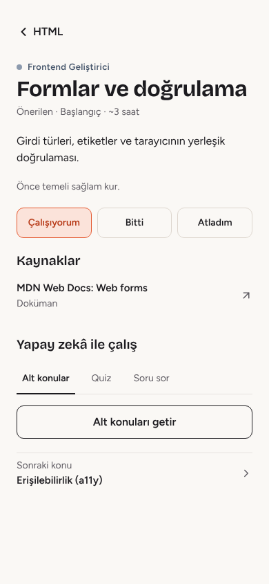
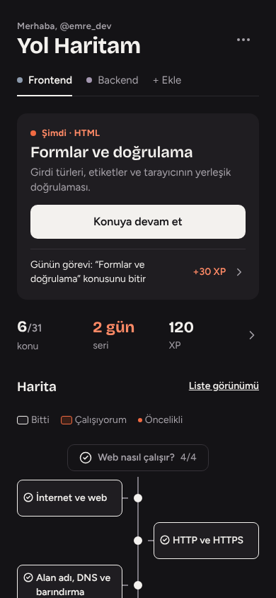
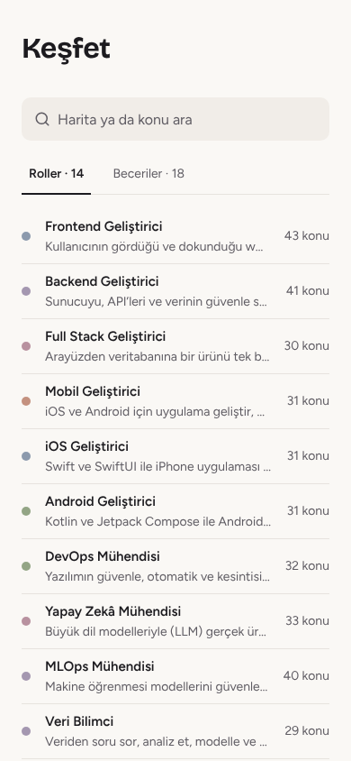
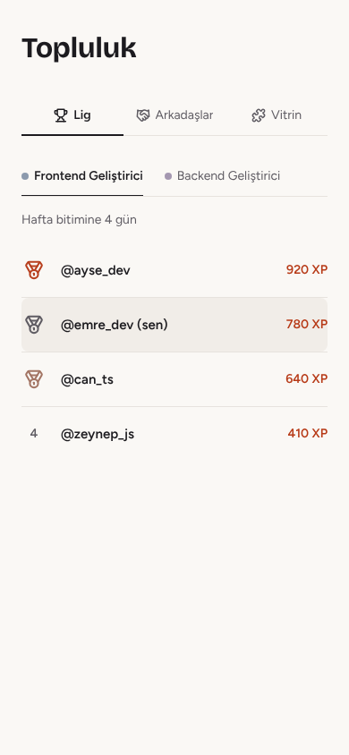

<div align="center">

# 🧭 Yol Haritam

**Yazılım öğrenmenin Türkçe yol haritası.**
Bir rol seç, konu konu ilerle, nerede kaldığını hiç unutma.


<br>

&nbsp;
&nbsp;
&nbsp;


</div>

---

## Neden?

Yazılım öğrenmeye başlayan herkes aynı duvara çarpar: *"Neyi, hangi sırayla öğrenmeliyim?"*
İnternette sayısız kaynak var ama bir sıra yok, çoğu da İngilizce.

**Yol Haritam** bu soruya cevap veriyor:

- 🗺️ Hedeflediğin rolü seçersin (Frontend, Backend, Mobil, DevOps, Yapay Zekâ…).
- 🌳 Önüne bölüm bölüm, konu konu bir harita çıkar. Her konunun yanında seçilmiş kaynaklar durur.
- ✅ Bitirdiğin konuyu işaretlersin, uygulama seni bir sonrakine götürür.
- 🤖 Takıldığın yerde yapay zekâ konuyu alt başlıklara böler, mini quiz hazırlar, soruna cevap verir.

Uygulamaya giriş yapmadan da göz atabilirsin. Hesap ancak ilerlemeni kaydetmek istediğinde gerekir.

## Neler var?

| | Özellik | Ne işe yarar |
|---|---|---|
| 🗺️ | **32 yol haritası** | 14 rol, 18 beceri. Toplam 1.033 konu ve 1.489 kaynak. Hiçbir konu kaynaksız değil. |
| 🌳 | **Liste + ağaç görünümü** | Haritayı düz liste ya da dallanan ağaç olarak gezersin, seçimin hatırlanır. |
| 🎯 | **"Şimdi" kartı** | Açınca ilk gördüğün şey: kaldığın konu ve tek bir "Konuya devam et" butonu. |
| 🔥 | **Seri, XP, rozetler** | Günün görevi, günlük seri, haftalık hedef ve başarımlar. |
| 🤖 | **Yapay zekâ ile çalış** | Kişiye göre işaretlenmiş harita. Her konu için alt konular, quiz ve soru sorma. |
| 📰 | **Gelişmeler** | Seçtiğin konulara göre 28 kaynaktan Türkçe yazılım haberleri: başlık, kısa özet, kaynağın bağlantısı. |
| 👥 | **Topluluk** | Haftalık lig, çalışma arkadaşları ve projeni paylaşabileceğin vitrin. Bildirme, engelleme ve kelime filtresi var. |
| 🌙 | **Açık / koyu tema** | "Mürekkep + mercan" paleti. İki temada da tüm renkler en az 4.5:1 kontrastta. |
| 🚪 | **Misafir modu** | Keşfet, harita önizleme, konular ve haberler girişsiz açık. |

<div align="center">
&nbsp;

<br><sub>Ekran görüntüleri test verisiyle alınmıştır.</sub>
</div>

## Kurulum

### 1. Telefonda dene (en hızlısı)

İhtiyacın olanlar: [Node.js](https://nodejs.org) (LTS sürümü) ve telefonuna [Expo Go](https://expo.dev/go) uygulaması.

```bash
git clone https://github.com/KASIMEMRE/yolharitam.git
cd yolharitam
npm install
npx expo start
```

Terminalde çıkan **QR kodu** Expo Go ile okut. Uygulama telefonunda açılır.

> 💡 Tarayıcıda görmek için terminalde `w` tuşuna bas.
> `a` tuşuna basma, o tuş bilgisayarında Android SDK kurulu olmasını ister.

Uygulama hazır bir Supabase sunucusuna bağlı gelir, ek ayar yapman gerekmez.
Kendi sunucunu kullanmak istersen `.env.local` dosyasına şunları yaz:

```bash
EXPO_PUBLIC_SUPABASE_URL=https://<proje>.supabase.co
EXPO_PUBLIC_SUPABASE_PUBLISHABLE_KEY=<yayınlanabilir-anahtar>
```

### 2. Telefona kurulabilir APK

```bash
npx eas-cli@latest build -p android --profile preview
```

Derleme bitince verilen bağlantıdan APK'yı indirip kur.
Bundan sonra `main` dalına giren her değişiklik telefona **kendiliğinden güncelleme** olarak gelir (EAS Update + GitHub Actions).
Ayrıntılar: [`docs/GUNCELLEME.md`](docs/GUNCELLEME.md)

### Faydalı komutlar

```bash
npx tsc --noEmit    # tip kontrolü
npx expo lint       # kod denetimi
npx expo start -c   # önbelleği temizleyip başlat
```

## Teknolojiler

```
┌──────────────────────────────┐        ┌──────────────────────────────────┐
│  📱 Uygulama                 │        │  ☁️ Supabase                    │
│                              │        │                                  │
│  Expo SDK 58 · React Native  │  ───▶ │   Postgres + Row Level Security  │
│  Expo Router (dosya tabanlı) │        │  Auth (e-posta + kullanıcı adı)  │
│  TypeScript                  │  ◀───  │  Edge Functions (Deno)           │
│  Reanimated · SVG · Lucide   │        │  pg_cron (haber toplama)         │
└──────────────────────────────┘        └───────────────┬──────────────────┘
                                                        │
                                                        ▼
                                              🤖 Groq (yapay zekâ)
```

| Katman | Kullanılan |
|---|---|
| **Arayüz** | React Native 0.88, Expo SDK 58, Expo Router, React 19 |
| **Dil** | TypeScript |
| **Görünüm** | Kendi tasarım sistemi (`src/constants/theme.ts`), yazı tipleri Bricolage Grotesque + Figtree, simgeler Lucide |
| **Animasyon** | react-native-reanimated, react-native-svg |
| **Arka uç** | Supabase: Postgres, RLS kuralları, Auth |
| **Sunucu kodu** | Supabase Edge Functions: `personalize-roadmap`, `generate-roadmap`, `topic-assist`, `fetch-news`, `delete-account` |
| **Yapay zekâ** | Groq. Anahtar yalnız sunucuda tutulur, uygulamada yoktur. |
| **Yayın** | EAS Build (APK) + EAS Update (OTA güncelleme) + GitHub Actions |

🔒 **Güvenlik notu:** Gizli anahtarlar (`service_role`, `GROQ_API_KEY`) repoda yok, yalnızca Supabase sırlarında duruyor.
Her tablo RLS ile korunuyor: herkes sadece kendi verisini görebilir.

## Proje yapısı

```
yolharitam/
├── src/
│   ├── app/                  # ekranlar (Expo Router: her dosya bir sayfa)
│   │   ├── (tabs)/           # alt sekmeler: Yol Haritam, Gelişmeler, Topluluk, Profil
│   │   ├── topic/            # konu ekranı
│   │   ├── map/              # harita önizleme
│   │   └── settings/         # ayarlar alt sayfaları
│   ├── components/           # ortak bileşenler (Surface, ListRow, Segmented…)
│   ├── constants/
│   │   ├── theme.ts          # renkler, yazı tipleri, boşluklar
│   │   └── dev-roadmaps/     # 32 haritanın içeriği
│   ├── hooks/                # veri ve tema kancaları (useNews, useLeague…)
│   └── lib/                  # Supabase istemcisi, oturum, yardımcılar
├── supabase/
│   ├── migrations/           # veritabanı şeması + RLS
│   └── functions/            # Edge Functions
└── docs/
    ├── plan/                 # tasarım ve iş planları, kabul raporları
    ├── dersler/              # her işten çıkan ders notları
    ├── yasal/                # gizlilik, kullanım koşulları, hesap silme
    ├── YAYIN.md              # mağazaya çıkış listesi
    └── GUNCELLEME.md         # otomatik güncelleme kurulumu
```

<div align="center">
<sub>
Harita kurgusu <a href="https://roadmap.sh">roadmap.sh</a>'tan ilham alır. İçerikler Yol Haritam için Türkçe yazılmıştır, roadmap.sh ile bağlantılı değildir.
<br>
Emre tarafından ❤️ ile yapıldı.
</sub>
</div>
